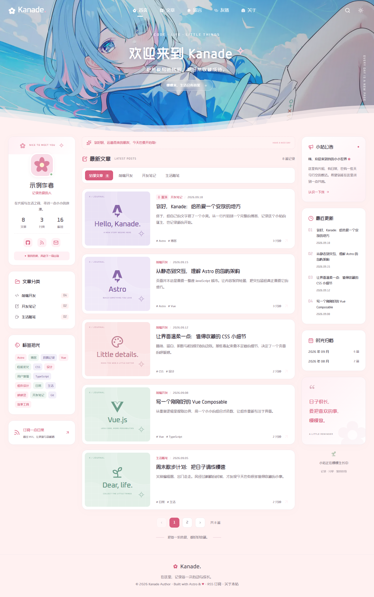

# 🌸 Tema Kanade Blog — IA 2.0

> Template blog estético, moderno e acolhedor estilo pastel japonês, desenvolvido com **Astro**, **Vue 3** e **Tailwind CSS**. Perfeito para blogs pessoais, artigos técnicos, tutoriais e projetos de conteúdo.



---

## ✨ Destaques do Template

- 🎨 **Estética Pastel & Minimalista**: Paleta suave, cantos arredondados, ondas decorativas e micro-interações fluidas.
- ⚡ **Desempenho Extremo**: Geração de HTML 100% estático com ilhas reativas Vue para busca e interações.
- 📝 **Compatível com IA 2.0**: Totalmente integrado com o fluxo de sincronização de posts (`src/content/blog`), autores, categorias e páginas institucionais (`src/data/`).
- 🔍 **Busca Instantânea**: Busca fuzzy em tempo real por título, categoria e tags com atalho global (`Ctrl / ⌘ + K`).
- 💌 **Mural de Recados Interativo**: Sticky notes coloridas que os leitores podem fixar diretamente no navegador.
- 🌓 **Modo Escuro & Claro**: Alternância suave de tema com salvamento de preferência.
- 📱 **100% Responsivo**: Layout de 3 colunas no desktop e visualização refinada em celulares e tablets.
- 🚀 **Deploy Automático**: Pipeline GitHub Actions para compilação e exportação de HTML estático.

---

## 📁 Estrutura de Conteúdo

```text
src/
├── content/
│   └── blog/               # Seus artigos em Markdown (.md)
├── data/
│   ├── siteConfig.json     # Nome, descrição, redes e contatos do site
│   ├── authors.json        # Lista de autores e biografias
│   ├── categories.json     # Categorias do blog
│   ├── menu.json           # Links do menu de navegação
│   ├── sobre.json          # Conteúdo da página Sobre
│   ├── contato.json        # Conteúdo da página Contato
│   ├── privacy.json        # Política de privacidade
│   └── terms.json          # Termos de uso
```

---

## 🛠️ Comandos Essenciais

```bash
# Instalar dependências
npm install

# Rodar localmente
npm run dev

# Compilar para produção (gera pasta dist/)
npm run build
```

---

Desenvolvido para a plataforma **Meu Site com IA (IA 2.0)**.
